<!--
╔══════════════════════════════════════════════════════════════════════════╗
║  RIFKILLAH MULIYA AL-FARIS · github.com/rifkillah                        ║
║  Liquid Glass profile — built from scratch with animated SVG.            ║
║                                                                          ║
║  Everything below is plain Markdown + hand-built SVG assets.             ║
║  No trackers, no external CSS, no scripts.                               ║
║                                                                          ║
║  Colours      #060A12 canvas · #6EA8FF blue · #6EE7B7 mint               ║
║               #A78BFA violet · #67E8F9 cyan · #FDA4AF rose               ║
║  Type         Inter / SF Pro / Segoe UI stack + JetBrains Mono           ║
║  Rebuild      python tools/build_assets.py                               ║
╚══════════════════════════════════════════════════════════════════════════╝
-->

<div align="center">

<picture>
  <source media="(min-width: 641px)" srcset="assets/hero.svg">
  
</picture>


</div>

<!-- ══════════════════════════════════════════════════════════════════════
     01 · ABOUT
     ══════════════════════════════════════════════════════════════════════ -->


### Halo, aku Rifki 👋

Aku **Rifkillah Muliya Al-Faris** — anak ketiga, tumbuh di Tangerang, dan sampai hari ini masih percaya bahwa hal-hal kecil bisa terasa seperti sihir.

Semuanya dimulai di usia **enam tahun**, bukan dari layar atau keyboard, tapi dari **kipas angin dan lampu**. Baling-baling yang berputar sampai mengeluarkan angin sejuk, dan bohlam yang membuat malam jadi terang — dua benda biasa yang membuatku berpikir: *kok bisa?* Dari pertanyaan sesederhana itu, rasa penasaran tumbuh jadi kebiasaan: menggambar rancangan, merakit maket dari kardus dan lidi, memotret, mengedit video, membongkar sistem Android, lalu belajar menulis kode.

Sekarang aku menempuh **S1 Teknik Informatika di Universitas Pamulang (2023)** dan menghabiskan sebagian besar waktu di antara **Figma, Android Studio, VS Code, dan terminal**. Aku suka membuat antarmuka yang terasa jernih, sistem yang rapi, dan cerita yang tersampaikan — karena teknologi terbaik adalah yang terasa manusiawi.

```yaml
# ── profile.yaml ─────────────────────────────────────────────────────────
name        : Rifkillah Muliya Al-Faris
alias       : [Rifki, rfklh, RfklhFaris]
based_in    : Tangerang, Banten, Indonesia  ·  UTC+7
education   : S1 Teknik Informatika — Universitas Pamulang, 2023–now

focus       : [UI/UX Design, Android Internals, Web Systems, Multimedia]
toolbox     : [Figma, Kotlin, Laravel, Python, Adobe CC, Git, Linux]
currently   :
  building  : Matfess — Liquid Glass study companion for Android
  learning  : Kotlin, Laravel, design systems, AI fundamentals
  open_to   : internship · freelance · meaningful collaboration

motto       : "Curiosity is a feature, not a bug."
```

<br/>

<table>
<tr>
<td width="33%" valign="top">

<b>🔭 Building</b>
Matfess — aplikasi pendamping kuliah Android dengan UI Liquid Glass, SQLite, dan Retrofit.

</td>
<td width="33%" valign="top">

<b>🌱 Learning</b>
Kotlin, Laravel, design system, dan dasar-dasar AI/ML untuk melengkapi sisi produk.

</td>
<td width="33%" valign="top">

<b>🤝 Open to</b>
Magang, proyek freelance UI/UX atau web, dan kolaborasi multimedia yang menarik.

</td>
</tr>
</table>

<!-- ══════════════════════════════════════════════════════════════════════
     02 · JOURNEY
     ══════════════════════════════════════════════════════════════════════ -->


> *"Kalau tidak tahan lelahnya belajar, maka kamu akan menanggung perihnya kebodohan."*
> — Imam Asy-Syafi'i

Enam bab yang membentuk cara aku melihat teknologi. Buka satu per satu — masing-masing punya pelajaran yang masih aku bawa sampai sekarang.

<details>
<summary><b>01 · Usia 6 — kipas, lampu, dan sihir pertama</b></summary>
<br/>

Kipas dan lampu adalah "teknologi" pertamaku. Aku bisa berdiri lama di depan kipas yang menyala, memperhatikan baling-balingnya berputar, lalu menempelkan tangan ke depannya untuk merasakan angin. Malam hari, lampu kamar jadi benda paling ajaib di rumah.

Dari situ aku mulai menggambar: rancangan bangunan, denah rumah, sketsa pakaian. Bukan karena diminta, tapi karena kepalaku penuh ide yang harus dikeluarkan.

> **Pelajaran:** rasa ingin tahu tidak butuh alat mahal. Kadang cukup satu benda yang berputar.

</details>

<details>
<summary><b>02 · Kelas 6 SD — juara 1 rangkaian elektronika</b></summary>
<br/>

Sekolah mengadakan tes merangkai lampu dan baterai. Aku berhasil membuat lampu menyala dan keluar sebagai **peringkat pertama**. Guruku sempat tidak percaya — katanya aku terlalu sering "main gambar" — lalu memintaku merangkai ulang di depan kelas.

Aku mengulanginya, dan hasilnya tetap sama. Momen itu mengajarkan sesuatu yang tidak ada di buku: **kemampuan membuktikan diri lebih berharga daripada sekadar dianggap mampu.**

> **Pelajaran:** validasi terbaik bukan pujian, tapi kemampuan mengulang hasil yang sama di depan orang lain.

</details>

<details>
<summary><b>03 · SMP — berbenah, berkebun, dan fotografi</b></summary>
<br/>

SMP adalah fase *reinventing*. Nilaiku tidak melesat, tapi naik perlahan dan konsisten. Di sisi lain, aku mulai menggambar secara digital, menanam cabai dan bunga di botol bekas, lalu menemukan **fotografi** lewat kegiatan ekstrakurikuler.

Berkebun mengajarku sabar; fotografi mengajarku melihat. Dua hal yang ternyata sangat berguna saat mendesain antarmuka.

> **Pelajaran:** pertumbuhan yang lambat tetap pertumbuhan. Tidak semua hal harus instan.

</details>

<details>
<summary><b>04 · SMK — multimedia jadi identitas</b></summary>
<br/>

Di SMK aku benar-benar tenggelam di dunia multimedia: **Photoshop, Premiere Pro, After Effects, Illustrator** — edit foto, animasi, video, desain grafis. Aku juga ikut membuat film pendek dan pernah menjadi aktor untuk tugas sekolah.

Tugas kuliah dan tugas sekolah kukerjakan tepat waktu. Nilai membaik bukan karena mendadak pintar, tapi karena aku mulai punya sistem: catat, kerjakan, selesaikan.

> **Pelajaran:** hobi bisa menjadi identitas profesional kalau disiplinnya ikut dibawa.

</details>

<details>
<summary><b>05 · 2023 — SNBP, satu pelajaran mahal</b></summary>
<br/>

Aku termasuk **tiga orang di kelas yang eligible** mendaftar SNBP. Tapi karena tidak ada informasi lanjutan tentang alur konfirmasi, aku melewatkan langkah terakhir dan dinyatakan gagal — bukan karena nilai, tapi karena aku tidak tahu harus klik apa dan kapan.

Awalnya menyesal. Setelah itu, aku sadar ada hal yang lebih penting daripada penyesalan: **informasi adalah bagian dari peluang.** Sejak saat itu aku selalu membaca ulang instruksi, mencari sumber resmi, dan bertanya kalau tidak paham.

Aku melanjutkan ke **Universitas Pamulang, Teknik Informatika, angkatan 2023** — dan justru di sini banyak hal yang sebelumnya cuma hobi mulai bertemu.

> **Pelajaran:** kesempatan bisa hilang bukan karena kurang mampu, tapi karena kurang informasi.

</details>

<details>
<summary><b>06 · 2023–kini — Android internals, UI/UX, dan Matfess</b></summary>
<br/>

Selama lebih dari **tiga tahun** aku mendalami sistem Android: *unlock bootloader*, root, Magisk, modul, sampai membereskan bootloop yang kubuat sendiri. Aku belajar membaca log, memahami partisi, dan menerima bahwa `fastboot` tidak selalu bekerja pada percobaan pertama.

Di sisi lain, aku makin serius di **UI/UX** — merancang tampilan web dan aplikasi yang futuristik tapi tetap nyaman dipakai. Aku juga pernah magang sebagai **admin sosial media**, menjawab pertanyaan mahasiswa dan mengelola konten.

Dari semua itu, aku membangun **Matfess**: aplikasi Android untuk mahasiswa, dengan tema **Liquid Glass**, database lokal, dan dua integrasi REST. Bukan proyek terbesar, tapi ini proyek yang paling jujur menggambarkan cara kerjaku: desain, kode, dan rasa penasaran dalam satu tempat.

> **Pelajaran:** spesialisasi itu bagus, tapi kemampuan menghubungkan banyak bidang adalah keunggulan tersendiri.

</details>

<!-- ══════════════════════════════════════════════════════════════════════
     03 · STACK
     ══════════════════════════════════════════════════════════════════════ -->


<div align="center">
</div>

Aku tidak mengklaim menguasai semuanya. Ini alat yang pernah kupakai untuk menyelesaikan sesuatu yang nyata — dari tugas kuliah sampai proyek pribadi.

| Area | Tools yang paling sering kupakai |
| --- | --- |
| **Front-end & web** | `HTML` `CSS` `JavaScript` `Tailwind` `React` `Next.js` |
| **Back-end & data** | `PHP` `Laravel` `Node.js` `Python` `MySQL` `REST API` |
| **Mobile & system** | `Kotlin` `Android SDK` `SQLite` `Retrofit` `ADB` `fastboot` `Magisk` |
| **Design & multimedia** | `Figma` `Photoshop` `Premiere Pro` `After Effects` `Illustrator` |
| **Daily drivers** | `VS Code` `Android Studio` `Git` `GitHub` `Linux` `Docker` |

<!-- ══════════════════════════════════════════════════════════════════════
     04 · WORK
     ══════════════════════════════════════════════════════════════════════ -->


<div align="center">
<a href="https://github.com/rifkillah/Matfess">
  
</a>
</div>

<br/>

| Repository | Apa isinya | Stack |
| --- | --- | --- |
| **[Matfess](https://github.com/rifkillah/Matfess)** | Aplikasi pendamping kuliah Android: catatan, tugas, jadwal, IPK, Pomodoro, all offline-first. | `Kotlin` `SQLite` `Retrofit` `Liquid Glass` |
| **[BetawiScript-Compiler](https://github.com/rifkillah/BetawiScript-Compiler)** | Mini compiler bahasa Betawi: lexer → parser → semantic → optimizer → TAC codegen. | `Python` |
| **[katalog-buku-e-perpustakaan](https://github.com/rifkillah/katalog-buku-e-perpustakaan)** | Katalog buku e-perpustakaan kampus dengan pencarian dan manajemen data. | `Laravel` `Blade` `MySQL` |
| **[restful-api-data-mahasiswa](https://github.com/rifkillah/restful-api-data-mahasiswa)** | RESTful API data mahasiswa + portal web sebagai konsumen API. | `Laravel` `REST` |
| **[sistem-portal-akademik-multi-role](https://github.com/rifkillah/sistem-portal-akademik-multi-role)** | Portal akademik dengan hak akses berbeda untuk tiap peran. | `Laravel` `Blade` |
| **[Toko-Berkah-jaya](https://github.com/rifkillah/Toko-Berkah-jaya)** | Kasir desktop Java Swing bertema glassmorphism, MySQL, dan transaksi manual commit. | `Java` `Swing` `MySQL` |
| **[Data-mining](https://github.com/rifkillah/Data-mining)** | Eksperimen pengolahan, pembersihan, dan analisis data. | `Python` |
| **[Website](https://github.com/rifkillah/Website)** | Eksplorasi ulang antarmuka web untuk tugas kuliah. | `HTML` `CSS` |

<div align="center">

<a href="https://github.com/rifkillah?tab=repositories"><b>Lihat semua 13 repositori →</b></a>

</div>

<!-- ══════════════════════════════════════════════════════════════════════
     05 · GITHUB LAB
     ══════════════════════════════════════════════════════════════════════ -->


Angka bukan tujuan, tapi berguna untuk melihat ritme. Yang paling menarik justru bukan grafiknya — melainkan kebiasaan kecil di baliknya: commit yang rapi, repositori yang diberi README, dan proyek yang benar-benar diselesaikan.

<div align="center">

<picture>
  <source media="(min-width: 641px)" srcset="assets/github-stats.svg">
  
</picture>

</div>

<sub>Kartu di atas dirender ulang otomatis setiap hari oleh GitHub Actions — angkanya diambil langsung dari API GitHub, bukan dari layanan pihak ketiga.</sub>

<!-- ══════════════════════════════════════════════════════════════════════
     06 · BEYOND CODE
     ══════════════════════════════════════════════════════════════════════ -->


Di luar editor, ada empat hal yang membuat kepalaku tetap waras — dan ternyata semuanya balik lagi ke cara aku bekerja.

<table>
<tr>
<td width="50%" valign="top">
  
  <br/><br/>
  <b>📷 Photography</b><br/>
  Sejak SMP. Belajar komposisi, cahaya, dan kesabaran menunggu momen yang tepat. Foto bukan sekadar dokumentasi — ini cara melihat.
</td>
<td width="50%" valign="top">
  
  <br/><br/>
  <b>🌿 Urban farming</b><br/>
  Cabai dan bunga di botol bekas. Sederhana, tapi mengajarkan bahwa pertumbuhan butuh waktu, konsistensi, dan lingkungan yang benar.
</td>
</tr>
<tr>
<td width="50%" valign="top">
  
  <br/><br/>
  <b>🎬 Short film</b><br/>
  Menulis, mengambil gambar, mengedit — dan pernah jadi aktor untuk tugas sekolah. Cerita yang baik selalu punya struktur, sama seperti kode.
</td>
<td width="50%" valign="top">
  
  <br/><br/>
  <b>✏️ Design & drawing</b><br/>
  Rancangan bangunan, sketsa pakaian, sampai wireframe aplikasi. Semua dimulai dari coretan di kertas sebelum jadi piksel.
</td>
</tr>
</table>

<!-- ══════════════════════════════════════════════════════════════════════
     07 · CONNECT
     ══════════════════════════════════════════════════════════════════════ -->


Aku terbuka untuk magang, proyek freelance, kolaborasi desain, atau sekadar diskusi soal Android, UI/UX, dan multimedia. Kalau pesanmu jelas dan niatnya baik, insyaAllah aku balas.

<div align="center">

<a href="https://www.instagram.com/rifklh.faris_"></a>
<a href="https://www.linkedin.com/in/rifkillahmaf/"></a>
<a href="https://github.com/rifkillah"></a>
<a href="https://www.tiktok.com/@rfklhhh_"></a>
<a href="https://x.com/Rfklh_Alfaris"></a>
<a href="https://youtube.com/@rifkiiii_lahh"></a>
<a href="https://pin.it/19sbrqNYb"></a>
<a href="https://www.threads.net/@rifklh.faris_"></a>
<a href="https://discord.gg/r2CYJydn"></a>
<a href="https://brainly.co.id/app/profile/20537154/answers"></a>

<br/><br/>

<a href="https://linkin.bio/rifklhmaf"><b>linkin.bio/rifklhmaf</b></a> &nbsp;·&nbsp; <a href="https://github.com/rifkillah"><b>github.com/rifkillah</b></a>

</div>

<!-- ══════════════════════════════════════════════════════════════════════
     FOOTER
     ══════════════════════════════════════════════════════════════════════ -->

<div align="center">
</div>

<div align="center">
<sub>© 2026 Rifkillah Muliya Al-Faris · dirancang dan dibangun dengan rasa penasaran</sub>
</div>

<!-- ══════════════════════════════════════════════════════════════════════
     BEHIND THE GLASS (buka kalau penasaran)
     ══════════════════════════════════════════════════════════════════════ -->

<details>
<summary><b>⚙️ Behind the glass — how this profile is built</b></summary>
<br/>

Semua visual di halaman ini adalah **SVG buatan sendiri**, bukan template pihak ketiga. Tidak ada `<style>` di dalam Markdown, tidak ada JavaScript, dan tidak ada elemen yang bergantung pada tema terang/gelap GitHub — setiap kartu membawa kanvasnya sendiri.

**Yang membuatnya terasa seperti kaca:**

- lapisan `white` 4–10% di atas kanvas gelap, dengan *rim* gradien 1px;
- garis spekular di tepi atas dan *sheen* yang bergerak diagonal;
- aurora blur di belakang panel, plus *grain* halus agar tidak terlihat datar;
- animasi CSS/SMIL: orbit cincin, chip mengambang, rotasi kata, marquee, dan *pulse* status;
- semua gerakan dimatikan otomatis lewat `prefers-reduced-motion`.

**Struktur repositori:**

```text
rifkillah/
├── README.md
├── INSTALL.md                ← panduan upload & kustomisasi
├── preview.html              ← buka di browser untuk melihat semua aset
├── assets/
│   ├── hero.svg              ← banner desktop (1200×640)
│   ├── hero-mobile.svg       ← banner iPhone (480×756)
│   ├── sec-*.svg             ← header tiap bagian
│   ├── stack.svg             ← rail teknologi animasi
│   ├── featured-matfess.svg  ← studi kasus Matfess
│   ├── hobby-*.svg           ← empat kartu hobi
│   ├── github-stats.svg      ← kartu "GitHub Signal" (desktop)
│   ├── github-stats-mobile.svg ← varian iPhone
│   ├── social/*.svg          ← badge kontak
│   ├── footer.svg
│   └── src/                  ← foto & ikon sumber untuk rebuild
├── .github/workflows/
│   └── profile-stats.yml     ← refresh kartu sinyal tiap hari
└── tools/
    ├── build_assets.py       ← generator semua aset visual
    └── build_stats.py        ← pengambil data GitHub → SVG
```

**Kustomisasi cepat:**

1. Ganti `assets/src/avatar.png` dengan fotomu, lalu jalankan `python tools/build_assets.py`.
2. Ubah palet di bagian atas `tools/build_assets.py` (`BLUE`, `MINT`, `VIOLET`, …).
3. Sesuaikan teks di `README.md`; aset tidak perlu diubah.
4. Untuk memperbarui angka statistik: `python tools/build_stats.py`, atau biarkan workflow harian yang mengerjakannya.
5. Untuk melihat hasilnya tanpa push: buka `preview.html` di browser.

**Kredit & lisensi:**

- Bahasa visual *Liquid Glass* terinspirasi dari proyek open-source [Liquid-Glass](https://github.com/zakisheriff/Liquid-Glass) oleh [@zakisheriff](https://github.com/zakisheriff) (MIT). Implementasinya di sini dibuat ulang dengan SVG murni, bukan memakai paket React-nya.
- Ikon teknologi dan brand berasal dari [Simple Icons](https://simpleicons.org/) (CC0 1.0).
- Kartu statistik dibuat sendiri dari [GitHub REST API](https://docs.github.com/rest) dan kalender kontribusi publik — tanpa layanan kartu pihak ketiga.

</details>
